# Colizeum Work

**Рабочее приложение компьютерного клуба внутри Telegram: смены, касса, задачи и оборудование.**

Администратор открывает смену, выполняет задачи, учитывает расходы и отправляет отчёт. Управляющий следит за текущей сменой и кассой, назначает задачи и проверяет результаты. Суперпользователь управляет доступом сотрудников и контролирует работу всей команды.

Интерфейс Mini App, панель Django, уведомления бота и сообщения об ошибках — на русском языке. Даты и время отображаются по Москве, суммы — в рублях. Денежные поля принимают запятую и точку в качестве десятичного разделителя.

> **Использование только с разрешения автора.** Личный, коммерческий, некоммерческий и локальный запуск запрещены без предварительного письменного разрешения [MihaDemon](https://github.com/MihaDemon). Полные условия — в [LICENSE](LICENSE).

## Как выглядит приложение

Скриншоты сделаны в браузере из текущего интерфейса Mini App на вымышленных данных с имитацией окружения Telegram. Это примеры экранов, а не сведения о реальных сотрудниках, платежах или сменах. Системная оболочка Telegram в снимки не входит.

<table>
  <tr>
    <th>Администратор: текущая смена</th>
    <th>Управляющий: задачи и касса</th>
    <th>Оборудование клуба</th>
  </tr>
  <tr>
    <td>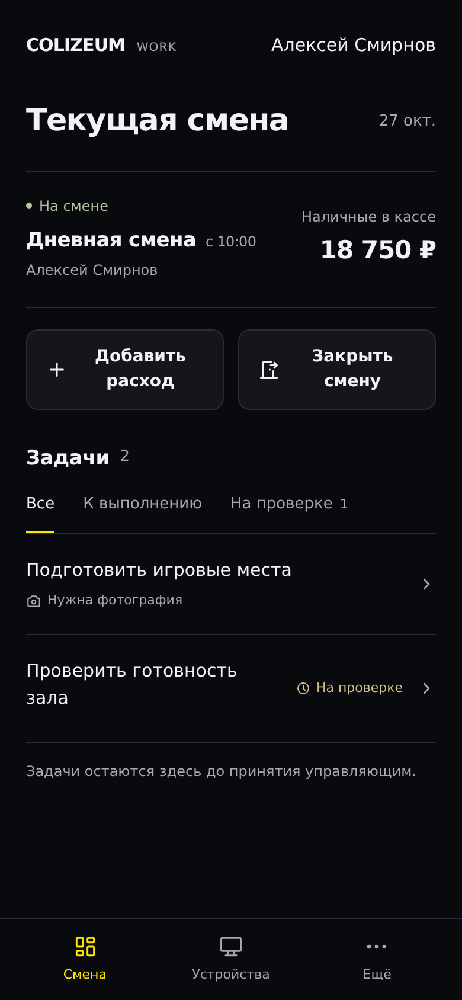</td>
    <td>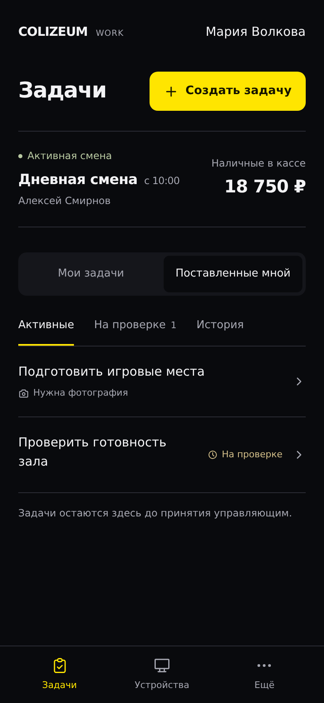</td>
    <td>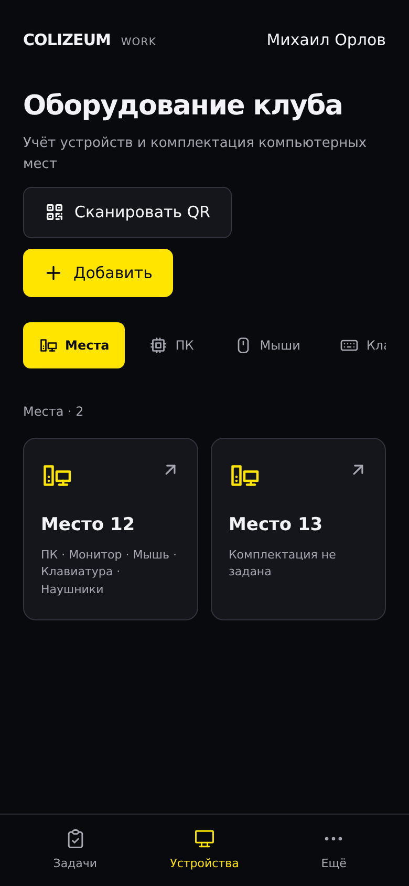</td>
  </tr>
</table>

## Возможности и роли

| Роль | Что доступно |
| --- | --- |
| **Администратор** | Открытие и закрытие своей смены, выполнение назначенных задач, отправка фотографий, учёт расходов, просмотр доступной истории и оборудования. |
| **Управляющий** | Активная смена и касса, задачи администратору текущей смены, проверка поставленных задач, личные задачи от суперпользователя, история и настройка фотографий отчёта. |
| **Суперпользователь** | Назначение задач администраторам и управляющим, просмотр и проверка всех задач, управление сотрудниками, полный доступ к созданию, изменению и удалению записей в Django Admin. Личных задач у суперпользователя нет. |

- **Одна активная смена.** Пока предыдущая смена открыта, другой администратор не может открыть новую. Тип смены выбирается при открытии и сохраняется до закрытия.
- **Касса и расходы.** Расход уменьшает наличные, требует сумму и описание; фотография чека необязательна. Списать больше остатка нельзя.
- **Задачи с проверкой.** Выполнение проходит через статус «На проверке». Принятие завершает задачу, отклонение возвращает её на доработку с объяснением.
- **Настраиваемые фотографии.** Для отчётов и задач можно задавать названия и обязательность снимков. Для задач также доступны одно фото или несколько фото без отдельных названий.
- **История смен.** В разделе «Ещё» доступны закрытые смены с разбивкой по наличным, карте и СБП, общей выручкой и фотографиями отчёта.
- **Оборудование.** Игровые места, компьютеры, мыши, клавиатуры, наушники, мониторы и PlayStation с отдельными значками. Поиск устройства — через камеру и QR-код.
- **Уведомления в Telegram.** После выполнения задачи её постановщик получает уведомление и может перейти к проверке.
- **События смены.** Об открытии и закрытии смены и каждом расходе бот уведомляет всех активных управляющих и суперпользователей с привязанным Telegram ID. Кнопка в сообщении открывает конкретную смену с отчётом или расход с чеком.
- **Уборщица.** Администратор своей открытой смены может один раз подтвердить приход уборщицы. Управляющие и суперпользователи получают сообщение с московскими датой и временем; история находится в «Ещё → Уборщица» и фильтруется по месяцу и году.
- **График смен.** Текущий и следующий полумесячные графики, ручное назначение, автозаполнение 2/2, версии и сравнение плана с фактическими сменами. Итог отправляется управляющим и суперпользователям изображением через сутки после окончания периода.

## Как пользоваться Mini App

### 1. Получить доступ и открыть смену

Суперпользователь добавляет сотрудника через **«Ещё → Персонал»** или Django Admin: имя, фамилию, телефон и роль. Здесь же он редактирует администраторов и управляющих и включает или отключает их доступ. Сотрудник открывает приложение через бота, подтверждает собственный контакт в Telegram и выбирает логин. После регистрации его номер не показывается на обычных экранах; в разделе персонала он доступен суперпользователю для редактирования. При следующих открытиях вход выполняется автоматически.

Администратор нажимает **«Открыть смену»**, выбирает дневную или ночную смену и подтверждает открытие. На главном экране появляются касса, задачи, кнопки **«Добавить расход»** и **«Закрыть смену»**. Управляющий видит активную смену и остаток кассы на странице задач.

### 2. Выполнить задачу и пройти проверку

Управляющий назначает задачу администратору текущей смены. Суперпользователь также может назначить задачу управляющему. В задаче указываются описание, приоритет и требования к фотографиям. Исполнитель получает сообщение в Telegram с кнопкой **«Открыть задачу»**.

Администратор открывает задачу, прикладывает обязательные снимки, при необходимости оставляет комментарий и нажимает **«Закрыть задачу»**. Задача остаётся в его списке со статусом **«На проверке»**. Постановщик получает уведомление в Telegram и принимает результат либо возвращает задачу на доработку. Только после принятия задача исчезает из текущего списка администратора.

<table>
  <tr>
    <th>Выполнение задачи</th>
    <th>Проверка управляющим</th>
  </tr>
  <tr>
    <td>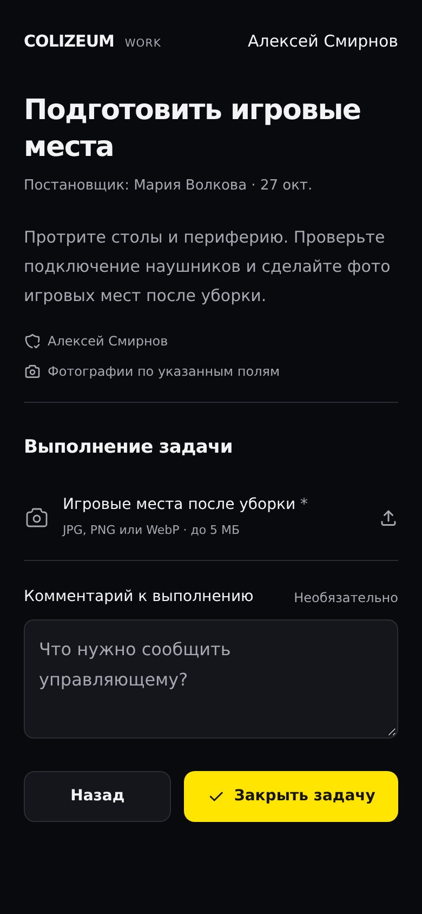</td>
    <td>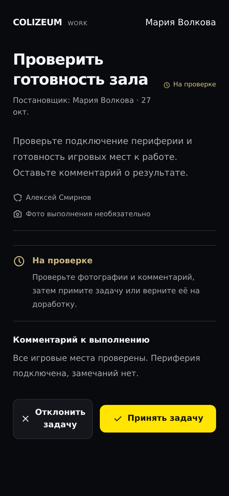</td>
  </tr>
</table>

### 3. Учесть расход и закрыть смену

Для расхода укажите сумму и причину. Фотографию чека можно приложить дополнительно. При закрытии смены внесите выручку наличными, по карте и через СБП, затем загрузите фотографии по настроенным полям. Тип смены берётся из её открытия. В кассу добавляется только наличная выручка; карта и СБП входят в общую сумму отчёта.

Суперпользователь может нажать на сумму **«Наличные в кассе»**, ввести новый остаток и сохранить его. Исправление не меняет отчёты или расходы; прежняя и новая сумма остаются в уведомлениях приложения. Если за время редактирования касса изменилась, приложение предложит обновить данные перед повторным исправлением.

<table>
  <tr>
    <th>Расход из кассы</th>
    <th>Отчёт при закрытии смены</th>
  </tr>
  <tr>
    <td>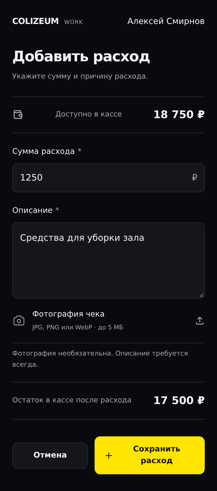</td>
    <td>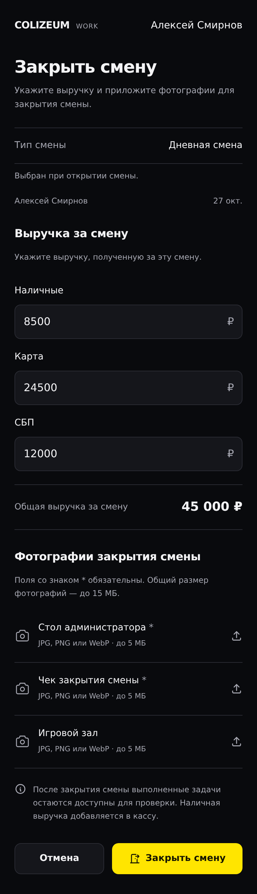</td>
  </tr>
</table>

### 4. Посмотреть историю и настроить фотографии

История смен доступна через **«Ещё → История смен/задач»**. Откройте смену, чтобы увидеть разбивку платежей и общий итог. На странице задач управляющего остаётся баннер активной смены; история вынесена в «Ещё».

В разделе **«Ещё → Фотографии отчёта»** управляющий или суперпользователь добавляет поля, задаёт названия снимков и отмечает обязательные. Изменения применяются к следующим сменам: открытая смена сохраняет требования, действовавшие в момент открытия.

<table>
  <tr>
    <th>История и итоги смены</th>
    <th>Настройка фотографий отчёта</th>
  </tr>
  <tr>
    <td>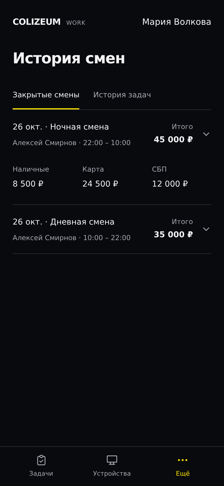</td>
    <td>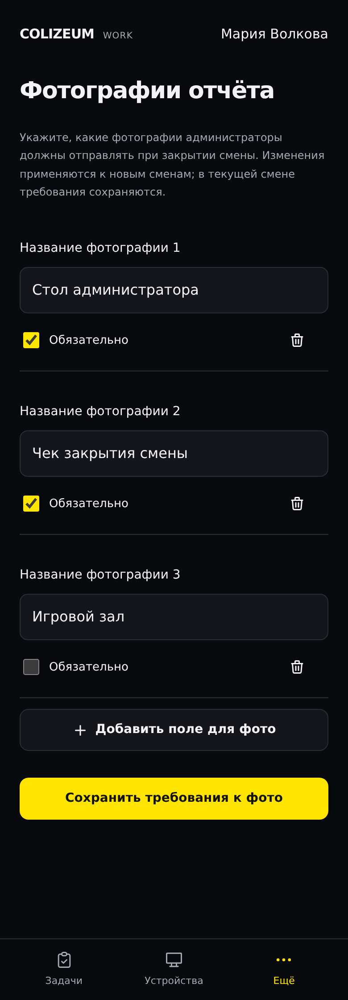</td>
  </tr>
</table>

### 5. Найти устройство по QR-коду

Откройте **«Устройства»**, запустите сканирование и наведите камеру на QR-код игрового места. В карточке доступны сведения об оборудовании и скачивание QR-кода. Ввод поискового запроса вместо камеры не предусмотрен. Управление инвентарём зависит от роли сотрудника.

В Telegram 8.0 и новее QR-код скачивается через встроенный диалог. На старых клиентах используется внешний браузер. Ссылка действует пять минут и даёт доступ только к одному PNG-файлу; токен авторизации в неё не включается.

### 6. Отметить приход уборщицы

Во время собственной открытой смены администратор нажимает **«Уборщица»** на экране смены и подтверждает действие. Отмена ничего не сохраняет и не отправляет. После подтверждения кнопка показывает время отметки и становится недоступной до следующей смены на экране смены. Повторный запрос, перезагрузка или одновременное нажатие на нескольких устройствах не создают второй приход. Дата и время прихода отображаются в формате **дд/мм/гг чч:мм** по Москве.

Сообщение управляющим и суперпользователям имеет вид **«Уборщица пришла 28/10/26 12:34»**; дату и время фиксирует сервер по Москве. Кнопка сообщения открывает историю за соответствующий месяц. В **«Ещё → Уборщица»** можно выбрать месяц и год, увидеть дату, время и отметившего сотрудника. Раздел и его API доступны только управляющим и суперпользователям; перехода к смене в этой истории нет. История сохраняется после удаления учётной записи сотрудника.

<table>
  <tr><th>Приход отмечен один раз за смену</th><th>История с фильтром по месяцу и году</th></tr>
  <tr>
    <td>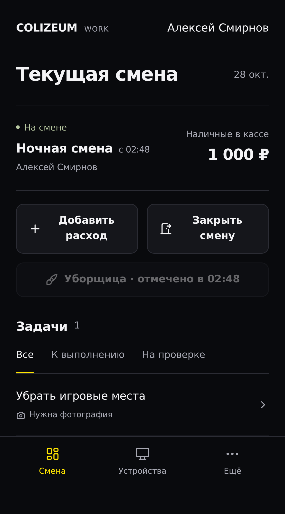</td>
    <td>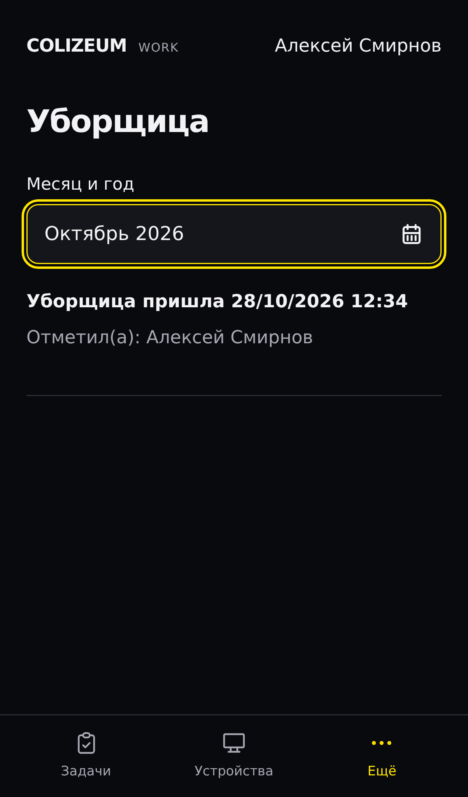</td>
  </tr>
</table>

### 7. Составить график смен

Откройте **«Ещё → График смен»**. Периоды: **1–15 число** и **16–последнее число месяца**; длина февраля и месяцев с 30 днями учитывается автоматически. Вкладки **«Текущий»**, **«Следующий»** и **«Архив»** доступны всем сотрудникам. Новый период автоматически становится текущим по московской дате, даже если никто не открывал Mini App в момент перехода.

Управляющий или суперпользователь нажимает **«Редактировать график»**, выбирает администратора и нажимает на дневные и ночные ячейки. Пункт **«Очистить ячейку»** снимает назначение. Изменения остаются черновиком до **«Сохранить график»**; уход с несохранёнными изменениями требует подтверждения.

Для следующего графика доступно **«Автозаполнение 2/2»**. Выбираются до четырёх действующих администраторов: первая пара работает два дня, затем её сменяет вторая. Цикл продолжается между периодами, а позиции дневной и ночной смены сохраняются для неизменившейся команды. При большем количестве сотрудников выберите четырёх для автоматического цикла; остальные доступны для ручных назначений.

Если выбрано меньше четырёх сотрудников, недостающие позиции заполняются **администратором по умолчанию**. Его выбирает только суперпользователь в настройках на странице графика. Это должен быть действующий администратор. Один запасной сотрудник может занимать несколько позиций, поэтому перед сохранением проверьте его нагрузку. Без выбранного запасного сотрудника автозаполнение неполной команды не выполняется. Автозаполнение создаёт только черновик, который можно поправить вручную и затем сохранить; для текущего и архивного графиков оно недоступно.

Каждое сохранение создаёт версию с автором и временем. Через **«Версии графика»** можно посмотреть старую версию и восстановить её как новую. Фактические смены при этом не меняются. Назначения в старых версиях сохраняют имена удалённых сотрудников; интерфейс отмечает недоступные назначения, а новые назначения можно делать только действующим администраторам. Одновременное сохранение не перезаписывает чужую работу: второй редактор получает сообщение о конфликте и может сохранить свой черновик на экране до решения обновить график.

При открытии смены сохраняется назначение из действовавшей версии. После закрытия календарь показывает фактически отработавшего сотрудника. Нажатие на ячейку раскрывает план выбранной версии, назначение при открытии, фактического администратора и времена смены. Управляющие и суперпользователи могут открыть отчёт; администраторы — отчёты своих смен. Незавершённые смены помечаются **«На смене»**. Ночная смена относится к дате открытия, даже если закрыта на следующий день. Несовпадение с графиком не блокирует открытие смены. Несколько фактических смен в одной ячейке сохраняются отдельно.

После окончания периода есть **полные сутки для исправлений через архив**. Для периода 1–15 итог готовится **17-го числа в 00:00**, для второй половины месяца — **2-го числа следующего месяца в 00:00 по Москве**. При создании или сохранении графика итоговое изображение не отправляется. Отправку запускает существующий `scheduler`, проверяющий срок раз в минуту: он формирует PNG с планом и фактом и ставит отдельное уведомление каждому активному управляющему и суперпользователю с Telegram ID. Кнопка сообщения открывает соответствующий архивный график. Повторная проверка не создаёт повторных заданий. После срока ручное редактирование закрывается; поздно закрытая фактическая смена продолжает отображаться в живом архиве, а отправленное изображение сохраняет состояние на момент подготовки.

Итоговое изображение также доступно внутри графика по авторизованному адресу. Новых переменных окружения и отдельных сервисов для графиков не требуется. После обновления кода примените миграции обычным пересозданием Compose-сервисов.

### 8. Управлять персоналом и уведомлениями

В **«Ещё → Персонал»** суперпользователь добавляет и редактирует сотрудников, выбирает роль и переключает доступ. В **«Ещё → Уведомления»** управляющие и суперпользователи сохраняют личные настройки Telegram. Сумму в кассе суперпользователь исправляет нажатием на неё.

<table>
  <tr><th>Персонал</th><th>Сообщения в Telegram</th><th>Исправление остатка</th></tr>
  <tr>
    <td>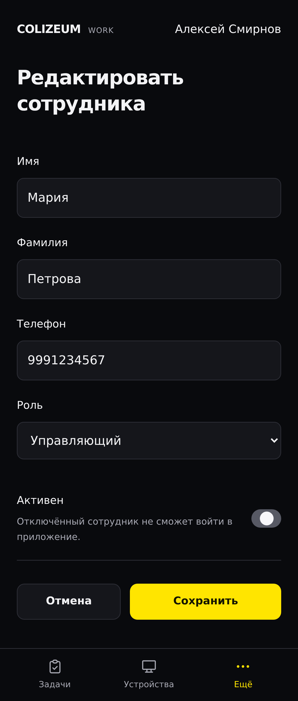</td>
    <td>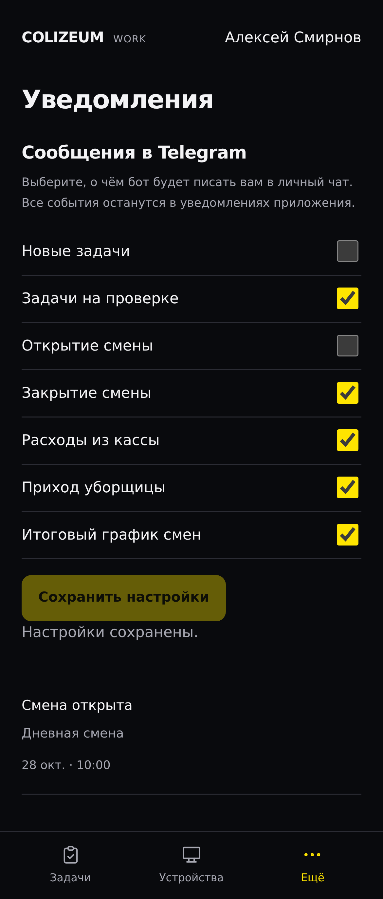</td>
    <td>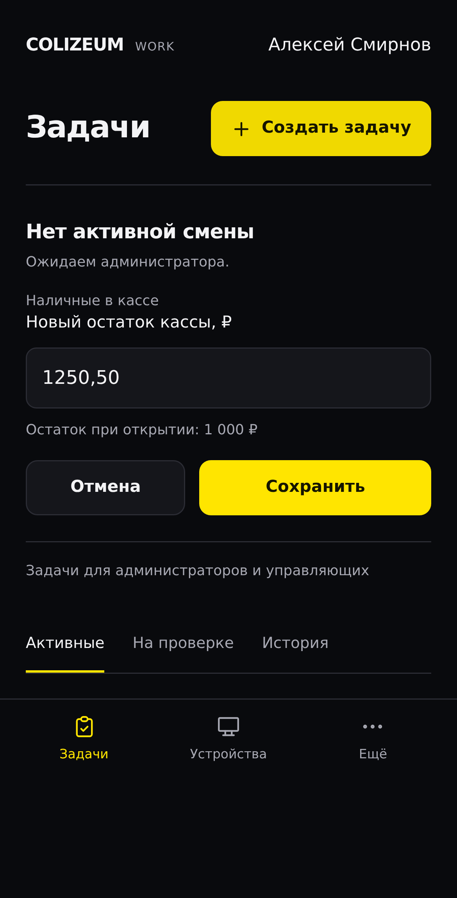</td>
  </tr>
</table>

## Технологии и устройство проекта

| Часть | Технологии и назначение |
| --- | --- |
| Интерфейс | React 19, TypeScript, Vite, Telegram Mini Apps API. |
| Сервер | Django, Django REST Framework, Gunicorn; проверка доступа и бизнес-правил. |
| База данных | PostgreSQL 16; смены, задачи, отчёты, расходы и история. |
| Telegram-бот | aiogram; открытие приложения и обработка контакта, запрошенного из Mini App. |
| Уведомления | Очередь в базе данных и отдельный обработчик повторных отправок. |
| Развёртывание | Docker Compose и один внутренний nginx; HTTPS на nginx хоста. |

```text
Telegram → nginx хоста с HTTPS → внутренний nginx
                                  ├── React
                                  └── Django API → PostgreSQL
Telegram-бот → Django API
Обработчик уведомлений → Telegram
```

Код интерфейса расположен в `frontend/`, сервер — в `backend/`, бот — в `bot/`. Конфигурация внутреннего nginx находится в `infra/nginx.conf`. Настройки всех сервисов хранятся в одном корневом `.env`.

## Развёртывание на сервере

Инструкции ниже предназначены для владельца проекта и пользователей, получивших письменное разрешение. Публикация инструкций не предоставляет разрешения на использование.

1. Если корневого `.env` ещё нет, создайте его из `.env.example`. Заполните `DJANGO_SECRET_KEY`, параметры PostgreSQL, `TELEGRAM_BOT_TOKEN`, `BOT_SERVICE_TOKEN` и публичный адрес `WEBAPP_URL`. Для каждого секрета используйте отдельное случайное значение, например:

   ```sh
   python -c 'import secrets; print(secrets.token_urlsafe(48))'
   ```

2. В `DJANGO_ALLOWED_HOSTS` добавьте домен приложения, `localhost`, `127.0.0.1` и `backend`. В `DJANGO_CSRF_TRUSTED_ORIGINS` укажите полный HTTPS-адрес, например `https://work.colizeum-perovo.com`. Для HTTPS оставьте `DJANGO_SECURE_COOKIES=True`.
3. Настройте nginx на хосте: HTTPS и проксирование на локальный порт шлюза. По умолчанию это `127.0.0.1:8000`; параметр `GATEWAY_PORT` меняет порт. Если другое приложение уже занимает `8000`, используйте `GATEWAY_PORT=8001` и направьте домен рабочего приложения на `127.0.0.1:8001`. Передавайте исходный `Host`, IP клиента и `X-Forwarded-Proto=$scheme`; внутренний шлюз сохраняет доверенный протокол.
4. Запустите сервисы:

   ```sh
   docker compose up -d --build
   docker compose ps -a
   docker compose logs migrate backend scheduler telegram_bot infra
   ```

5. В BotFather задайте адрес Mini App, совпадающий с `WEBAPP_URL`. Перед ожиданием уведомлений сотрудник должен открыть личный чат с ботом. Для одного токена запускайте один экземпляр бота с опросом Telegram. Если ранее использовался вебхук, удалите его перед переходом на опрос.

| Сервис | Назначение |
| --- | --- |
| `db` | База PostgreSQL 16. |
| `migrate` | Миграции, сбор статики Django и создание первого суперпользователя, если заданы его настройки. |
| `backend` | Django и Gunicorn; внутренний порт `8000`. |
| `scheduler` | Отправка уведомлений Telegram из очереди. |
| `frontend` | Копирование собранного интерфейса в общий том. |
| `telegram_bot` | Открытие Mini App и обработка контактов. |
| `infra` | Внутренний nginx; порт опубликован только на локальном интерфейсе хоста. |

`migrate` и `frontend` выполняются однократно: состояние **Exited (0)** для них нормально. Шлюз ожидает готовности сервера и файлов интерфейса. После обновления исходников пересоберите и пересоздайте сервисы:

```sh
docker compose up -d --build --force-recreate
```

В образ интерфейса попадают только собранные файлы. Сервер и бот исключают тесты, локальные базы, загруженные фотографии, секреты и служебные материалы разработки. Демонстрационного входа или маршрута обхода авторизации нет.

## Суперпользователь и доступ сотрудников

Перед первым запуском задайте `OWNER_USERNAME`, надёжный `OWNER_PASSWORD` и, при необходимости, `OWNER_TELEGRAM_ID`. Инициализация создаёт суперпользователя, только если такого логина ещё нет. При последующих запусках пароль и права существующего пользователя не перезаписываются. Альтернативный способ:

```sh
docker compose exec backend python manage.py createsuperuser
```

В Mini App откройте **«Ещё → Персонал → Добавить сотрудника»** или в `/admin/` откройте **«Администраторы»** и создайте карточку `AdminUser`: имя, фамилия, телефон и роль **«Администратор»** (`admin`) либо **«Управляющий»** (`manager`). Допускаются десять цифр, номер с `+7` или с `8`; новые записи сохраняют десять цифр. Telegram ID, логин и пароль на этом этапе не нужны. Учётная запись `User` пока не создаётся.

Сотрудник отправляет `/start` боту, открывает Mini App и нажимает **«Подтвердить телефон Telegram»**. Контакт должен принадлежать самому сотруднику, а номер — совпадать с карточкой допуска. После выбора логина создаётся обычный `User` с именем, фамилией и ролью из карточки. Для администраторов используется `is_staff=False`, для управляющих — `is_staff=True`; права суперпользователя им не выдаются. Ручного ввода телефона и контактной клавиатуры бота нет. Запрос контакта требует Telegram 6.9 или новее.

Telegram ID в `AdminUser` заполняется автоматически и доступен только для чтения в панели Django. Изменения имени, фамилии, роли и активности синхронизируются с учётной записью. В разделе персонала можно исправить телефон: связанный пользователь и его история сохраняются. В панели Django телефон существующей карточки доступен только для чтения. Переключатель **«Активен»** отключает вход и регистрацию, отзывает действующие токены; повторное включение возвращает доступ. Суперпользователей в разделе персонала не редактируют. Суперпользователю для входа в Mini App нужен числовой Telegram ID в его `User`.

Суперпользователь имеет права просмотра, создания, изменения и удаления записей во всех зарегистрированных разделах Django Admin, включая смены, задачи и кассу. При этом действуют проверки модели: одна активная смена, неотрицательный остаток и защищённые связи исторических записей.

Удалить сотрудника можно через **«Пользователи»** или **«Администраторы»**, в том числе массово. Удаление `User` через Django Admin также удаляет связанную карточку допуска: сотрудник не сможет зарегистрироваться повторно, пока ему не создадут новую карточку. Токены отзываются, но смены, задачи, выполнения, фотографии, отчёты, расходы и остаток кассы сохраняются. Историческое имя получает отметку **«(удалён)»**. Открытую смену удалённого сотрудника нужно переназначить другому администратору в разделе **«Смены»**. Задачи удалённого постановщика может проверить суперпользователь.

## Правила учёта и хранения данных

- Администратор выполняет задачи во время своей смены; управляющий может выполнять личные задачи без открытой смены. Незавершённые задачи сохраняются для дальнейшей работы.
- Для задачи можно выбрать необязательное фото, одно обязательное фото, несколько обязательных снимков без названий либо именованные поля с отдельной обязательностью. Режим нескольких снимков требует хотя бы одно изображение и допускает до десяти.
- Каждая отправка задачи сохраняет собственные доказательства выполнения. При доработке можно оставить выбранные фотографии и заменить остальные, не изменяя предыдущую отправку. При отклонении обязателен комментарий о необходимых исправлениях.
- Управляющий видит задачи, которые поставил или получил сам, и их историю. Суперпользователь видит и проверяет задачи всей команды.
- Общая выручка смены — сумма наличных, карты и СБП. Касса учитывает только наличные. Расходы списываются из неё и не могут сделать остаток отрицательным.
- Импортированные отчёты показывают записанную дату без выдуманного времени открытия и закрытия.
- Фотографии принимаются в JPG, PNG и WebP: до 5 МБ на файл, до десяти изображений и до 15 МБ новых файлов в одной отправке. Доступ к доказательствам выполнения идёт через авторизованные `/api/files/`. nginx блокирует прямой `/media/` и публичный доступ к `/api/bot/`.
- Денежные операции используют транзакции и ключи повторного запроса, чтобы повторная отправка не создавала двойного списания.
- Уведомления о задачах, сменах, расходах и приходе уборщицы попадают в очередь в той же транзакции, что и запись события. Обработчик повторяет неудачную доставку с увеличением интервала, до десяти попыток. Если Telegram принял сообщение, а обработчик прервался до записи результата, уведомление может прийти повторно; задача, денежная операция и отметка прихода при этом не дублируются.
- В **«Ещё → Уведомления»** управляющий или суперпользователь выбирает свои сообщения в Telegram: новые задачи, задачи на проверке, открытие и закрытие смены, расходы, приход уборщицы и итоговый график. Пункт «Новые задачи» есть только у управляющих: суперпользователю задачи не назначаются. По умолчанию все доступные типы включены. Выключение касается только личного чата с ботом: события продолжают появляться в приложении. Отключённые сообщения не отправляются задним числом при повторном включении. Администраторы получают сообщения о назначенных им задачах без этих настроек.

Ошибки отправки видны в Django Admin. После исправления доступа к чату или настроек бота суперпользователь может повторить неудачные уведомления через панель либо командой:

```sh
docker compose exec backend python manage.py dispatch_notifications --retry-failed
```

## Обслуживание и резервные копии

Постоянные данные хранятся в томах `postgres_data`, `django_media`, `django_static` и `frontend_build`. Сохраняйте резервные копии базы и загруженных фотографий. Пример выгрузки базы и команд диагностики:

```sh
docker compose exec db sh -c 'pg_dump -U "$POSTGRES_USER" "$POSTGRES_DB"' > backup.sql
docker compose exec backend python manage.py check
docker compose logs -f backend scheduler telegram_bot
```

`docker compose down` сохраняет данные. Команда `docker compose down -v` удаляет тома проекта.

Существующие локальные файлы SQLite, резервные копии и фотографии сохраняются и не включаются в образы. Compose использует отдельную PostgreSQL. Для переноса старых данных остановите запись, сохраните SQLite и фотографии, примените миграции к копии базы, выгрузите данные через `dumpdata`, исключив типы содержимого, права, сессии и токены авторизации. Импортируйте данные в пустую подготовленную PostgreSQL при `OWNER_USERNAME=`. Скопируйте фотографии в `django_media` с владельцем `10001:10001` и проверьте остатки, количество записей и снимки перед переключением пользователей. Финансовые исправления выполняются через Django Admin с записью в журнале действий.

Тома старого развёртывания на PostgreSQL 17 автоматически не используются в этой конфигурации с PostgreSQL 16. Перенос выполняется через выгрузку и восстановление данных; каталог PostgreSQL 17 нельзя напрямую подключить к PostgreSQL 16.

## Разработка и проверки

Тесты остаются в репозитории для сопровождения и исключаются из производственных образов. Установите зависимости сервера и бота в отдельных виртуальных окружениях, затем выполните:

```sh
cd backend
python manage.py test api reports computers workflows
cd ../bot
python -m unittest tests
cd ../frontend
npm ci
npm test
npm run build
npx playwright install --with-deps chromium
npm run test:e2e
```

Сценарий `frontend/tests/run-stack.sh` создаёт временное окружение Docker с тестовыми настройками вне репозитория, добавляет вымышленных сотрудников, запускает серверные и браузерные проверки и удаляет контейнеры и тома только этого тестового проекта. Исходники тестов подключаются только в тестовый контейнер. Порт `18080` должен быть свободен; его можно изменить через `SMOKE_GATEWAY_PORT`. Настоящий бот и обработчик уведомлений не запускаются. Проверки одновременных операций выполняются на PostgreSQL и пропускаются на SQLite.

Для локальной разработки интерфейса используйте `npm run dev` в `frontend/` и `API_PROXY_TARGET` в корневом `.env`. Vite читает этот же файл; в браузер передаются только переменные с префиксом `VITE_*`, поэтому секреты не должны использовать такой префикс. Авторизация остаётся через Telegram, в том числе при разработке через HTTPS-туннель. Камеру телефона, системный запрос контакта и настоящую доставку уведомлений нужно проверять на реальном устройстве с настроенным ботом и публичным HTTPS-адресом.

## Лицензия и разрешение автора

**Авторское право © 2026 MihaDemon. Все права защищены.**

Проект предоставлен для ознакомления. Личное, коммерческое, некоммерческое, учебное использование, локальный запуск, развёртывание, изменение и распространение оригинальных материалов требуют предварительного письменного разрешения правообладателя. Бесплатность и указание авторства не заменяют разрешение. Для согласования обратитесь к [MihaDemon](https://github.com/MihaDemon). Полные условия находятся в [LICENSE](LICENSE); лицензии сторонних зависимостей сохраняют силу.

Публичный репозиторий GitHub позволяет просмотр и создание форка в пределах условий платформы; это не предоставляет разрешения запускать приложение или использовать его в личных и коммерческих целях. Подробнее — в [документации GitHub о лицензировании репозиториев](https://docs.github.com/en/repositories/managing-your-repositorys-settings-and-features/customizing-your-repository/licensing-a-repository).
